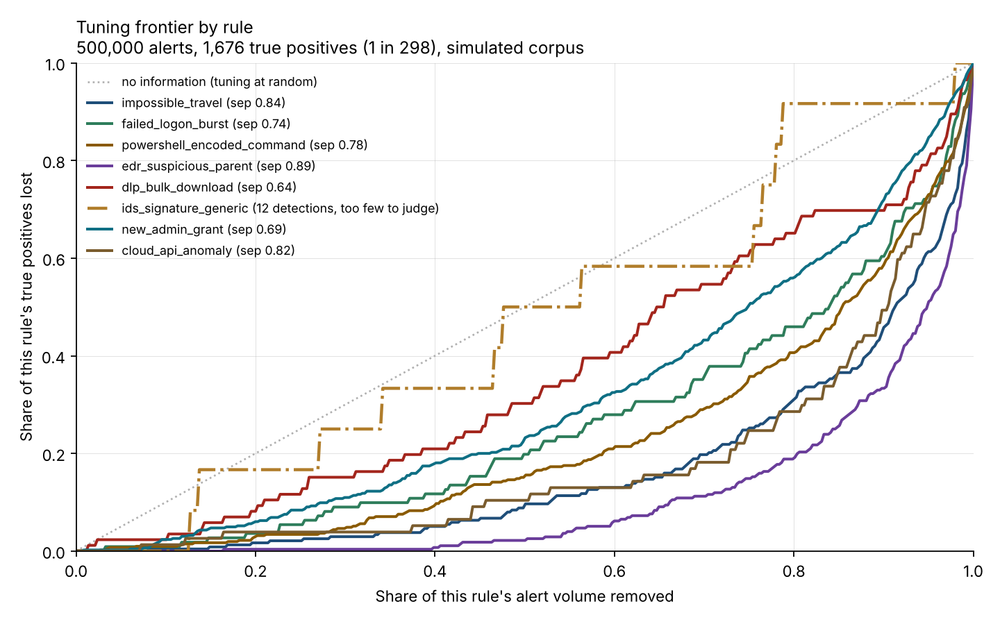
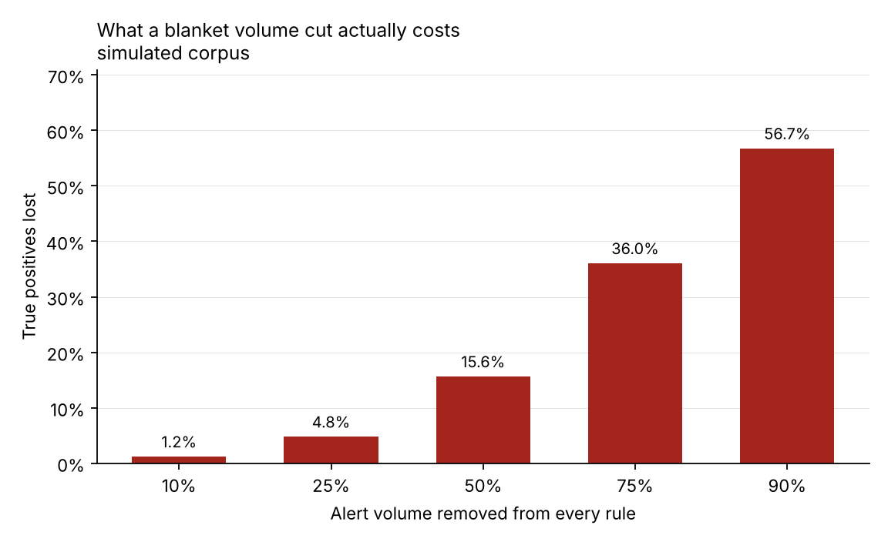
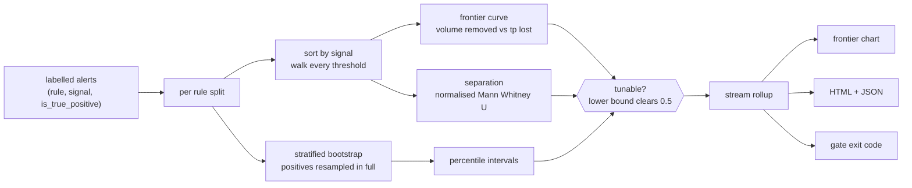

# alert-triage-economics

**Replays labelled alert streams to cost a tuning change. On the bundled corpus, halving alert volume costs <!--number:analysis.blanket_cut_cost.cut_50-->15.6<!--/number--> percent of true positives.**

[](https://github.com/__GITHUB_USERNAME__/alert-triage-economics/actions/workflows/ci.yml)
[](https://github.com/__GITHUB_USERNAME__/alert-triage-economics/actions/workflows/coverage-badge.yml)
[](docs/metrics.json)
[](https://__GITHUB_USERNAME__.github.io/alert-triage-economics/)
[](LICENSE)

## What this solves

- **"We reduced false positives by 60 percent" is reported without its cost.** This computes the cost: for every candidate threshold, volume removed against true positives lost. Halving volume on the bundled corpus costs <!--number:analysis.blanket_cut_cost.cut_50-->15.6<!--/number--> percent of detections, and a quarter costs <!--number:analysis.blanket_cut_cost.cut_25-->4.8<!--/number--> percent.
- **Some rules cannot be judged at all, and nobody checks which.** <!--number:analysis.unmeasured_rule_count-->1<!--/number--> of <!--number:analysis.rules_analysed-->8<!--/number--> rules here has only <!--number:analysis.unmeasured_true_positives-->12<!--/number--> detections across <!--number:analysis.unmeasured_volume_pct-->9.0<!--/number--> percent of the stream. The tool reports it as unmeasured rather than guessing, because below <!--number:analysis.min_true_positives_for_verdict-->20<!--/number--> detections a bootstrap interval can be narrow and badly wrong.
- **It runs as a CI gate on a tuning proposal.** `ate gate --cut 0.25 --max-tp-loss-pct 5` exits non zero when a proposed volume reduction costs more detections than the budget allows.

## The notebook version

I started this to settle an argument with myself about a line on my own CV.

Every SOC engineer has written some version of "reduced alert volume by N
percent". I have written it. It is almost always true, and it is almost always
incomplete, because the sentence has a second half nobody collects: and it cost
us M detections. Not because anyone is hiding M, but because measuring it means
going back over a labelled alert history and asking, for every threshold you
could have picked, which real detections would have fallen below it.

That is a tractable computation, so this does it.

Feed it a labelled alert stream: one row per alert, with the rule that fired,
the value of whatever signal a tuning change would key on, and whether an
analyst dispositioned it as real. Sorting a rule's alerts by that signal and
walking down gives every threshold at once, and for each one, two numbers:
volume removed, and true positives lost. Plot one against the other and you have
the rule's frontier.



Each line is one rule. The dotted diagonal is what tuning at random looks like:
remove half the volume, lose half the detections. A line bowing below it is a
rule worth tuning. The dashed grey line sitting on the diagonal is
`ids_signature_generic`, and it is the most useful thing in the chart.

### The rule the tool refuses to judge

`ids_signature_generic` produces <!--number:analysis.unmeasured_volume_pct-->9.0<!--/number--> percent of the corpus and <!--number:analysis.unmeasured_true_positives-->12<!--/number--> true positives. Its tuning signal is the severity score assigned by whoever wrote the signature, which says nothing about whether any particular alert is real. It is in the corpus deliberately, so the tool has a chance to get it wrong.

Its point estimate for removable volume is 12.7 percent, which reads as a
perfectly good tuning opportunity. Its separation statistic, the probability a
random true positive outscores a random noise alert, is 0.537 with a 95 percent
interval of 0.378 to 0.691. A signal with no information produces 0.5, so the
interval straddles chance and the first version of this tool reported the rule
untunable on that basis.

That looked like the safety property working. It was luck.

The same rule on a 200,000 alert corpus holds six detections, and the tool
reported it **tunable**, with an interval of 0.611 to 0.960. Narrow, confident,
comfortably clear of chance, and wrong by construction. A bootstrap resamples
the detections it has; with six of them it measures how the statistic moves
under reweighting those six, and it has nothing to compare them against to
notice they are unrepresentative. If all six score high, every replicate scores
high.

So there are three verdicts here, not two. Below <!--number:analysis.min_true_positives_for_verdict-->20<!--/number--> detections, measured as the point where a no-signal rule stopped being green lit across a sweep, the answer is that there is not enough evidence to say, and unmeasured never reads as tunable. [ADR-005](docs/adr/adr-005-insufficient-evidence.md) has the measurement.

The distinction matters because the actions differ. An untunable rule needs a
better signal. An unmeasured rule needs a longer window. Collapsing the two
sends an engineer to redesign a rule that may be perfectly good.

### The number I stopped leading with

The first version of this README led with free volume: the share of alerts
removable without losing a single detection, <!--number:analysis.free_volume_pct-->6.5<!--/number--> percent here, which is <!--number:analysis.free_hours-->4,320<!--/number--> analyst hours at <!--number:analysis.minutes_per_alert-->8.0<!--/number--> minutes per alert.

Then I ran the benchmark across three corpus sizes and watched it move from 17.3
percent to 6.5 percent to 2.7 percent on the same stream. Free volume is an
order statistic of the minimum: it is set entirely by where the single lowest
scoring detection sits, so a longer window finds a lower one and the number
falls. Holding separation and true positive rate fixed and only growing the
window, it falls by a factor of four while separation holds to three decimals.

The cost of halving volume moved from 16.8 to 15.6 to 16.2 percent across the
same three runs. So that is the headline now, free volume keeps its caveat
wherever it appears, and [ADR-004](docs/adr/adr-004-which-number-to-lead-with.md)
records why. Two tests pin both behaviours, including one that fails if free
volume ever stops shrinking, because that would mean the caveat had quietly
become false.



## Architecture



Three columns go in and nothing else. The tool never reads alert payloads,
usernames, hostnames or timestamps, because the frontier is a function of the
signal's distribution within each class and nothing more. An export prepared for
this tool is three columns wide, which is a much smaller thing to protect than an
alert history.

## Tech stack

| Technology | Role in this project | Why chosen here |
| --- | --- | --- |
| Python 3.11+ | Core, CLI, tooling | The language the SOC automation around it is already written in |
| numpy | Frontier curve, rank statistics, bootstrap | The whole computation is cumulative sums over sorted arrays; this is what that is for |
| pandas | Corpus handling, per rule splits | A year of one tenant's alerts fits in memory, so a dataframe is the right size of tool. See ADR-002 on what was not needed |
| pyarrow | Parquet engine behind pandas | Nothing imports it; pandas raises without it. Recorded in `tools/check_dependencies.py` so "not imported" and "not needed" stay distinguishable |
| matplotlib | The frontier chart | The chart is the deliverable, not an illustration |
| Typer | CLI with three verbs | Typed arguments and subcommands with a small dependency surface |
| Jinja2 | HTML report | The report is what gets attached to a tuning proposal |
| pytest, pytest-cov | <!--number:quality.test_count-->124<!--/number--> tests, <!--number:quality.test_coverage_pct-->99.3<!--/number--> percent branch coverage | Runs with no network, no API keys and no containers |

## Quickstart

Prerequisites: Python 3.11 or newer, and git. No containers, no SIEM, no credentials.

```bash
git clone https://github.com/__GITHUB_USERNAME__/alert-triage-economics.git
cd alert-triage-economics
python -m venv .venv && source .venv/bin/activate
make install
make verify
```

Then analyse a generated corpus:

```bash
ate generate --alerts 500000 --out data/generated/alerts.parquet --seed 7
ate frontier --alerts data/generated/alerts.parquet \
  --out docs/report.html --json docs/frontier.json
```

To use your own alerts, export three columns to parquet, `rule`, `signal` and
`is_true_positive`, and point `--alerts` at that instead. At that point the
numbers stop being a simulation.

To gate a tuning proposal in CI:

```bash
ate gate --alerts alerts.parquet --cut 0.25 --max-tp-loss-pct 5
```

Exit code 2 means the proposed cut costs more detections than the budget. The
budget is a policy decision: pick it from what the analysis reports today and
ratchet it, because a budget nobody can meet gets disabled within a week.

## Performance under load

The bootstrap dominates everything. The frontier itself is a sorted cumulative
sum and is effectively free; computing <!--number:analysis.bootstrap_resamples-->2,000<!--/number--> stratified replicates per rule is the work. Measured with `benchmark/run_benchmark.py`, median of 3 runs, on 2 vCPU with 8GB RAM, Python 3.13 on Linux. Raw output is in `benchmark/results/benchmark.json`.

| Alerts | Corpus size | Analysis (median) | Throughput |
| --- | --- | --- | --- |
| <!--number:performance.scenarios[0].alerts-->50,000<!--/number--> | <!--number:performance.scenarios[0].corpus_mb-->0.3<!--/number--> MB | <!--number:performance.scenarios[0].analyse_median_s-->9.17<!--/number--> s | <!--number:performance.scenarios[0].alerts_per_second-->5,450<!--/number--> alerts/s |
| <!--number:performance.scenarios[1].alerts-->500,000<!--/number--> | <!--number:performance.scenarios[1].corpus_mb-->2.6<!--/number--> MB | <!--number:performance.scenarios[1].analyse_median_s-->34.2<!--/number--> s | <!--number:performance.scenarios[1].alerts_per_second-->14,624<!--/number--> alerts/s |
| <!--number:performance.scenarios[2].alerts-->2,000,000<!--/number--> | <!--number:performance.scenarios[2].corpus_mb-->9.3<!--/number--> MB | <!--number:performance.scenarios[2].analyse_median_s-->38.4<!--/number--> s | <!--number:performance.scenarios[2].alerts_per_second-->52,118<!--/number--> alerts/s |

Throughput rises with corpus size, which looks wrong until you see why: the
bootstrap cost is fixed per rule, not per alert, because the noise pool is capped
at 20,000 draws per replicate regardless of how many alerts the rule has. See
[ADR-002](docs/adr/adr-002-capped-noise-pool.md) for the measurement behind that
cap and why it does not change the interval. Runtime is therefore roughly
proportional to rule count times resample count, and nearly flat in alert volume
above a few hundred thousand.

Where it degrades: a corpus with hundreds of distinct rules. At 2000 resamples a
rule, 300 rules would take about 20 minutes. `--resamples` is the lever, and
400 is enough for a gate check while 2000 is right for a published report.

## Architecture decision records

Four decisions in [`docs/adr/`](docs/adr/), each with the options rejected and why:

- [ADR-001](docs/adr/adr-001-bootstrap-over-point-estimates.md): bootstrap intervals over point estimates, and why the stratification is a requirement rather than a refinement.
- [ADR-002](docs/adr/adr-002-capped-noise-pool.md): capping the resampled noise pool, with the table showing it does not move the interval.
- [ADR-003](docs/adr/adr-003-synthetic-corpus.md): shipping a synthetic corpus, and putting a rule in it that cannot be tuned.
- [ADR-004](docs/adr/adr-004-which-number-to-lead-with.md): the boring choice. Lead with the stable number rather than the intuitive one.
- [ADR-005](docs/adr/adr-005-insufficient-evidence.md): a third verdict, because an interval cannot tell you that your sample is unrepresentative.

## Intentionally out of scope

**Recommending a threshold.** The tool reports what each candidate costs. It
never picks one. A tool that automatically suppressed alerts on the strength of a
bootstrap interval would be a worse idea than the problem it solves, and the
decision belongs to someone who knows what the organisation can afford to miss.

**Writing tunings back to the SIEM.** No Splunk savedsearch diffs, no Sentinel
rule updates. Trigger to add them: once the frontier has been used to ship real
tunings and the diffs are being written by hand anyway.

**Multivariate tuning.** One signal per rule. Real tuning often combines two or
three conditions, and the frontier for a combination is a surface rather than a
curve. That is a genuinely harder problem and a different tool.

**Alert content.** Three columns in. Nothing here reads a payload, and a change
that did would change what a user has to export and therefore what they have to
protect.

**Causal claims.** The frontier says what would have happened to these alerts
under this threshold. It does not say what an attacker would have done
differently had the threshold been in place, and no replay can.

## Security and compliance

The labelled alert corpus is the most sensitive thing a SOC holds: it records not
only alert detail but which attacks were real and, by implication, which were
missed. That is why this repository ships a generator rather than data, and why
the tool reads three columns and never alert content. The report contains rule
names, counts and statistics, so it is safe to attach to a ticket.

No network calls in the analysis path, no credentials, no writes to the SIEM.
Rule names are escaped in the report because they come from somebody else's
system. Full threat model in [SECURITY.md](SECURITY.md).

## Failure modes

| Failure | Detection | Behaviour | Recovery |
| --- | --- | --- | --- |
| Corpus missing a required column | Checked before analysis | `ValueError` naming the missing columns | Export `rule`, `signal`, `is_true_positive` |
| Corpus empty | Checked before analysis | `ValueError`, exits non zero | An empty export is a pipeline failure, not a finding |
| Rule has no true positives in the window | Positive count checked | Reported untunable, removable volume zero | Correct: no evidence either way, and zero is the conservative answer |
| Rule below the volume threshold | Counted before analysis | Listed as skipped, not analysed | Lower `ATE_MIN_RULE_VOLUME` if you want it anyway |
| Rule below the detection minimum | Detection count checked before the verdict | Reported unmeasured, never tunable, whatever the interval reads | Collect a longer window. See ADR-005 |
| Rule with a wide interval above the minimum | Interval width | Reported untunable unless the lower bound clears 0.5 | Improve the signal, not the window |
| Signal is constant | Rank statistic on ties | Separation near 0.5, reported untunable | Correct: a constant signal is not a tuning lever |
| Analysis window too short | Free volume figure inflates | Caveat stated wherever free volume appears | Prefer the blanket cut cost, see ADR-004 |
| Hundreds of rules | Runtime | Linear in rule count | Lower `--resamples` for a gate check |
| Published number drifts | `tools/check_numbers.py` in CI | Build fails | `make report`, update the document |

## Hardest problem solved

The bug was in one character, and the reason it survived is the interesting part.

`_first_loss` answers "how much volume can be removed before the first true
positive is lost". It reads the frontier curve, finds the cut points where zero
detections are lost, and takes one of them. I wrote `clean[-1]`.

The array is ordered by how many alerts you keep, ascending, so removable volume
runs the other way, from almost everything down to nothing. The indices where
loss is zero are a contiguous run at the end, and the last of them is "keep
every alert", which removes nothing. So `_first_loss` returned exactly 0.0, for
every rule, every time.

Which is a value that looks like an answer. Zero removable volume is a perfectly
plausible thing for a tuning tool to report: it means this rule cannot be safely
tuned at all, which is a real condition the tool is built to detect. Every rule
in the corpus returning it read as a severe but coherent result, and I spent a
while looking at the corpus generator for the reason the rules were all so badly
behaved, because the number was not absurd enough to point at itself.

What broke it open was writing the ten alert example that is now
`test_curve_on_a_worked_example`. Ten alerts, true positives at sorted positions
four and eight, so keeping the top eight keeps both and removes 20 percent. I
worked it out on paper first, which is the only reason the test was useful: the
function returned 0.0 against a number I already knew. The fix is `clean[0]`.

The lesson I took from it is about plausible wrong answers. A crash or a
negative percentage would have been found in minutes. A statistic that is wrong
and still inside its own valid range gets rationalised, and the only defence is
having an expected value computed independently of the code. Every statistic in
`src/ate/frontier/` now has a worked example test small enough to check by hand,
and that is a convention in CONTRIBUTING rather than a one off.

A second bug, found the same way: a rule with no true positives at all reported
that nearly its whole volume was removable for free. With no detections, every
cut point is trivially lossless, so the first zero loss index is the most
aggressive cut available. The data says there is no evidence either way, not
that the rule is safe to suppress, so that case now returns zero explicitly.

The no-detections fix is [`b6d278f`](../../commit/b6d278f); the `clean[-1]` direction was corrected before the frontier module was first committed, so it lives in the worked example test rather than in a fix commit of its own.

## Future work

- **Multivariate frontiers.** Two signals make the frontier a surface. The honest version reports the Pareto front rather than a single curve, and it is the most requested thing a tuning engineer would actually want.
- **Run against a real labelled corpus.** Every number here is a simulation, labelled as one. A real alert history behind an NDA would replace the single most questionable thing in this repository.
- **Time stratified frontiers.** A rule's signal distribution drifts. Computing the frontier per month would show whether a tuning that was safe in January still is.
- **Before production use:** confirm the disposition labels mean what you think. A corpus where "closed as benign" was conflated with "not a true positive" will produce confident numbers about a question you did not ask.
- **First metric to watch after deploying:** not volume. Watch the separation statistic per rule over time, and the count of unmeasured rules alongside it. A rule whose separation is falling is one whose tuning is about to start costing more than it did; a growing unmeasured list means detections are getting rarer, which is either very good news or a broken pipeline.

## License

MIT. See [LICENSE](LICENSE).
